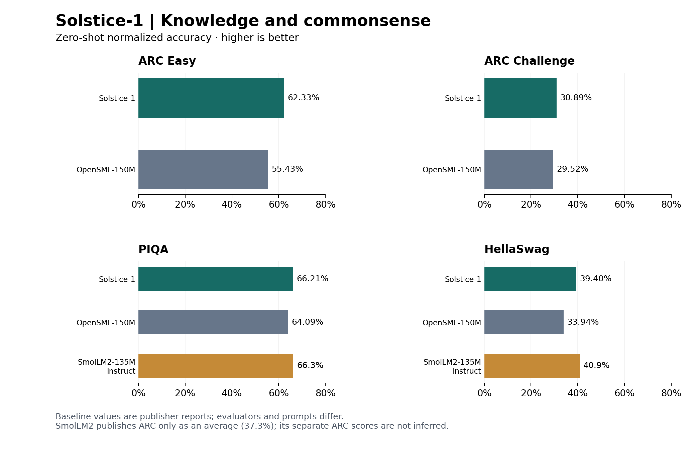
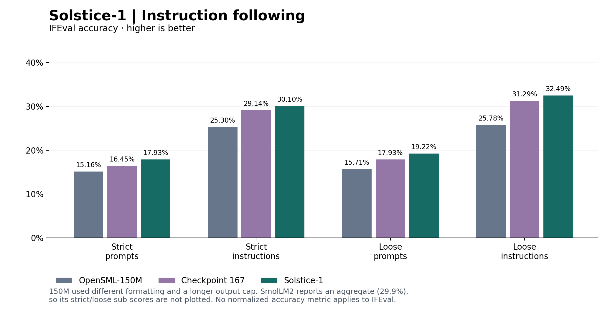
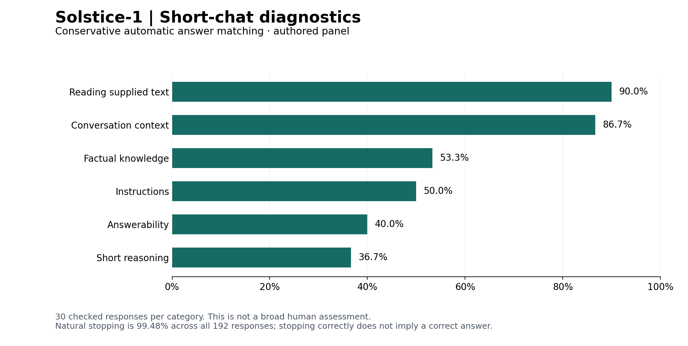
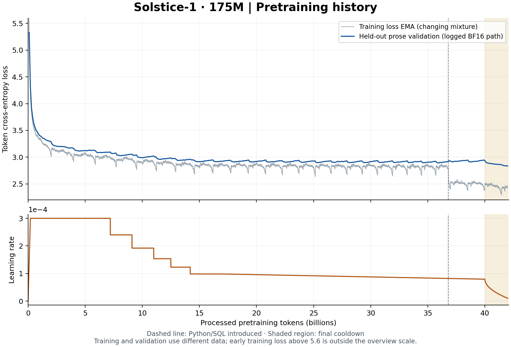
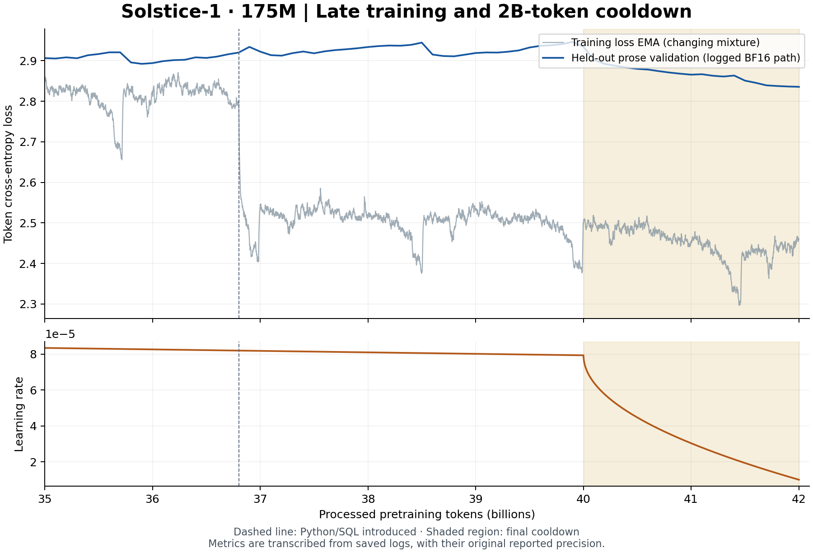

---
language:
- en
license: apache-2.0
pipeline_tag: text-generation
library_name: mlx
tags:
- small-language-model
- from-scratch
- text-generation
- conversational
- apple-silicon
- research
datasets:
- HuggingFaceTB/smollm-corpus
- HuggingFaceTB/dclm-edu
- HuggingFaceFW/finewiki
- hongliu9903/stack_edu_python
- hongliu9903/stack_edu_sql
- iNeil77/SynSQL-2.5M
- HuggingFaceTB/smol-smoltalk
- HuggingFaceTB/smoltalk
- rajpurkar/squad_v2
- allenai/sciq
---

# Solstice-1

**A 175M-parameter English chat model, trained from scratch on five Macs.**

William Zebrowski · OpenSML · Apache-2.0 · Research preview

[Weights](https://huggingface.co/OpenSML/Solstice-1) · [Source](https://github.com/williamzebrowskI/Solstice-1) · [Run guide](RUN_GUIDE.md) · [Technical report](docs/TECHNICAL_REPORT.md) · [Evaluation](docs/EVALUATION.md) · [Data](docs/DATA.md)

Solstice-1 is the first model in the Solstice family. It combines **42.001B pretraining tokens** with three stages of adapter fine-tuning for short conversations, reading comprehension and instruction following. The release includes merged FP32 weights, the original tokenizer, an MLX runner, training records and benchmark outputs.

## Model specification

| Setting | Value |
| --- | --- |
| Parameters | 175M rounded; 174,202,432 exact |
| Transformer | 44 layers; hidden width 576; SwiGLU width 1,536 |
| Attention | 9 query heads, 3 KV heads; head dimension 64 |
| Components | RoPE (base 10,000), RMSNorm, Q/K normalization, tied embeddings |
| Tokenizer | 32,000-token byte-level BPE, reused from OpenSML |
| Context | 2,048 tokens, including conversation history and generated output |
| Pretraining | 42,001,367,040 processed token positions |
| Release | Merged FP32 safetensors; native MLX on Apple Silicon |

Solstice-1 has a separate weight lineage from OpenSML-150M and OpenSML-JSONLite-175M. Reusing the tokenizer does not make those models its weight ancestors.

## Measured results

### Knowledge and commonsense

Zero-shot likelihood scoring on the complete ARC Easy, ARC Challenge, PIQA and HellaSwag evaluation splits. Accuracy ranks the total answer log-likelihood; `acc_norm` ranks it after dividing by answer length in characters. Higher is better.

| Benchmark | Solstice-1 acc / acc_norm | OpenSML-150M acc / acc_norm | SmolLM2-135M Instruct acc / acc_norm |
| --- | --- | --- | --- |
| ARC Easy | 62.58 / 62.33 | 56.65 / 55.43 | — / — |
| ARC Challenge | 29.35 / 30.89 | 26.02 / 29.52 | — / — |
| PIQA | 66.49 / 66.21 | 64.53 / 64.09 | — / 66.3 |
| HellaSwag | 32.85 / 39.40 | 30.55 / 33.94 | — / 40.9 |

All values are percentages, shown as **acc / acc_norm**. SmolLM2 publishes ARC only as a combined average (**37.3% acc_norm**); separate Easy/Challenge scores are unavailable in its card.



### Instruction following

IFEval checks whether generated responses follow explicit instructions. It measures accuracy, with separate strict and loose scoring at the prompt and instruction levels. **It has no `acc_norm` metric.**

| IFEval accuracy | Solstice-1 | OpenSML-150M | SmolLM2-135M Instruct |
| --- | --- | --- | --- |
| Strict prompts | 17.93% | 15.16% | — |
| Strict instructions | 30.10% | 25.30% | — |
| Loose prompts | 19.22% | 15.71% | — |
| Loose instructions | 32.49% | 25.78% | — |
| Publisher prompt/instruction average | — | — | 29.9% |



Solstice uses greedy generation, no system message or repetition penalty, and a 1,024-token output cap. Of 541 prompts, 130 reach that cap; they remain in the scores. The 150M release used a 1,280-token cap and a different chat format.

Baseline scores come from the published [OpenSML-150M card](https://huggingface.co/OpenSML/OpenSML-150M) and [SmolLM2-135M-Instruct card](https://huggingface.co/HuggingFaceTB/SmolLM2-135M-Instruct), not fresh reruns. “—” means the required breakdown is not published in those cards. SmolLM2 reports ARC and IFEval as averages; no missing sub-scores are inferred.

Solstice uses native MLX FP32 scoring. SmolLM2 uses LightEval; its [evaluation code](https://github.com/huggingface/smollm/tree/438be18dae658a638f3a6976fdf5190bb6d68619/text/evaluation/smollm2) specifies character-normalized choice scores with a leading space excluded and instruct runs with a chat template. OpenSML-150M uses an older native pipeline. Prompt formatting, precision and generation budgets differ, so these are reference comparisons, not a controlled leaderboard. [Exact sources and metric definitions](results/baselines/published_models.json).

### Conversation checks

A separate authored chat panel measures short-answer matching and response behavior. These automatic checks are narrower than human judgments of conversation quality.

| Measure | Solstice-1 |
| --- | ---: |
| Answer accuracy, objective cases | 59.44% |
| Natural stopping, all responses | 99.48% |
| Repetition flags, all responses | 1.56% |



The panel contains 180 checked answers and 12 open-ended responses. Repetition flags were reviewed: two were clear loops and one was a milder repeated idea. The full panel and scorer are included in [the saved results](results/public/chat/results.json).

On the separate reserved authored test, Solstice reaches **51.9%**, versus **20.0%** after SFT 1 and **25.9%** after SFT 2. On an older, reused panel, the corresponding scores are **53.84%, 52.13% and 54.55%**: the last stage does not improve every measure. The [evaluation report](docs/EVALUATION.md) explains selection, uncertainty and test exposure.

## Pretraining

Pretraining starts from random weights. Five Apple Silicon workers use BF16 compute with FP32 master weights, gradients and optimizer state. The 2,048-token sequence length and accumulated batch produce **131,072 token positions per update**. AdamW uses betas (0.9, 0.95), weight decay 0.1 and gradient clipping at 1.

### Data mixture

| Source | First 36.801B tokens | Remaining 5.200B tokens |
| --- | ---: | ---: |
| FineWeb-Edu | 70% | 56% |
| DCLM-Edu | 20% | 16% |
| English FineWiki | 10% | 8% |
| Python: public Stack-Edu text mirror | — | 15% |
| SQL: public Stack-Edu text mirror / configured continuation | — | 5% |

These are configured token shares, not measured unique-token counts. Data is streamed with bounded shuffling, quality filters, a recent-document deduplication window and fixed train/validation partitioning. The tokenizer stays frozen. Exact dataset revisions, filtering rules and upstream terms are in [Data provenance](docs/DATA.md).

### Loss and learning rate



The learning rate warms up to 3e-4, then changes through the recorded continuation schedules. At 40.001B tokens, a final 2B-token cooldown lowers it from 7.94e-5 to 1e-5. The selected base finishes at **42.001B tokens**, with prose validation loss **2.8356** on the training-time BF16 evaluation path.



The shaded region is the cooldown; the dashed line marks the addition of Python and SQL. Training loss uses the changing mixture, while prose validation uses a fixed holdout. Their levels should not be treated as the same measurement. [Curve data](results/pretraining_validation.csv) · [Schedule details](docs/TECHNICAL_REPORT.md#5-distributed-optimization-and-schedules)

## Fine-tuning

All three stages run on one Mac. They train rank-32 LoRA adapters on attention projections, plus the two chat-boundary token rows: **3.786M trainable parameters**. Each stage starts fresh optimizer moments and inherits the previous stage's adapters. The release merges these updates into the original FP32 base weights.

| Stage | Selected updates | Training data and objective |
| --- | ---: | --- |
| SFT 1 | 2,000 | Two passes over 48,000 conversations; assistant-only supervision with 20% prose-replay loss |
| SFT 2 | 256 | Editing, constraints, dialogue and grounding; conversational replay and a parent-distribution penalty |
| SFT 3 | 128 | Short reasoning, grounding, dialogue and abstention; replay and a lighter parent-distribution penalty |

Public SFT sources include Smol-SmolTalk, SmolTalk everyday conversations, SQuAD v2 and SciQ, alongside authored tasks. Whole conversations are retained; oversized examples and dedicated code, SQL, JSON and tool tasks are excluded from the selected text-chat recipe. The largest stage-1 conversation is 1,385 serialized tokens, within the 2,048-token context.

The final stage was planned for 256 updates; **only its first 128 are in this release**. It was selected using development checks before evaluation on the reserved test. This lineage uses supervised fine-tuning with replay and KL preservation, not DPO or reinforcement learning. Checkpoint 167 is a comparison model, not an ancestor. [Stage recipes, learning rates and selection](docs/TECHNICAL_REPORT.md#6-selected-fine-tuning-lineage) · [Exact lineage](provenance/LINEAGE.json)

## Recorded examples

Greedy FP32 outputs reproduced in the release environment. The incorrect example is included to show the gap between fluent answers and factual reliability.

| Prompt | Model answer | Assessment |
| --- | --- | --- |
| What is the capital of Japan? Give a short answer. | Tokyo | Correct |
| Anika brought a teal notebook. Greta brought a black notebook. What color was Anika’s notebook? | teal | Correct; supplied-text question¹ |
| Which planet is closest to the Sun? Give a short answer. | venus | Incorrect; the answer is Mercury |

¹ The full prompt also asks the model to use only the supplied information and give a short answer. Full prompts, a conversation-correction example and stop reasons are in [Recorded examples](docs/EXAMPLES.md).

## Run locally

Use Python 3.11 on Apple Silicon. While the repository is private, sign in with `hf auth login` after installing `huggingface_hub`.

```bash
python3.11 -m venv .venv
source .venv/bin/activate
python -m pip install huggingface_hub
hf download OpenSML/Solstice-1 --local-dir Solstice-1
cd Solstice-1
python -m pip install -r requirements.txt
python inference.py --prompt "What is the main function of the heart?" --max-new-tokens 96
python inference.py --interactive
```

The runner defaults to greedy FP32 generation and uses the native chat tokens. Interactive mode retains previous turns; `/reset` clears history and `/quit` exits. Inputs that exceed the shared context budget are rejected rather than silently truncated. [Sampling and conversation options](RUN_GUIDE.md).

The supplied runner is the supported inference path. Transformers AutoModel, MLX-LM auto-loading, GGUF and CUDA have not been validated for this package. A clean-environment check reproduced 27 saved responses exactly; this verifies the package, not general answer quality. [Verification record](PACKAGING_VERIFICATION.json).

## Limitations

- **Factual errors:** plausible explanations and short answers can be wrong.
- **Instruction following:** strict IFEval prompt accuracy is 17.93%; many longer outputs reach the token cap.
- **Answerability:** the model can decline questions whose answers are provided, yet invent answers when information is missing. Results depend strongly on wording.
- **Repetition:** loops and repeated ideas remain possible, particularly in open-ended responses.
- **Scope:** reliable coding, SQL, JSON extraction, tool use, multilingual use and long conversations are not established capabilities.
- **Evaluation coverage:** public and historical tests informed earlier research. The reserved test shares authored task families with training. No comprehensive semantic contamination audit, independent human study or safety assessment is claimed.

Solstice-1 is a research release for short English text and chat. It is not a dependable source of facts or a validated system for consequential decisions.

## Files, reproducibility and license

[Technical report](docs/TECHNICAL_REPORT.md) · [Data provenance](docs/DATA.md) · [Evaluation and failure analysis](docs/EVALUATION.md) · [Training archive](TRAINING_AND_REPRODUCIBILITY.md) · [Raw benchmark summary](results/public/summary.json)

The repository includes weights on Hugging Face, tokenizer files, inference code, sanitized training snapshots, frozen recipes, selected-checkpoint hashes, curves and saved evaluation outputs. Raw corpora, optimizer binaries and all ancestor weights are not bundled. The training archive documents the run; it is not a verified one-command retraining package.

Weights and author-controlled code use [Apache-2.0](LICENSE). Upstream datasets and third-party code retain their own terms. [Source notice](SOURCE_NOTICE.md) · [Third-party notices](THIRD_PARTY_NOTICES.md) · [Citation](CITATION.cff)
