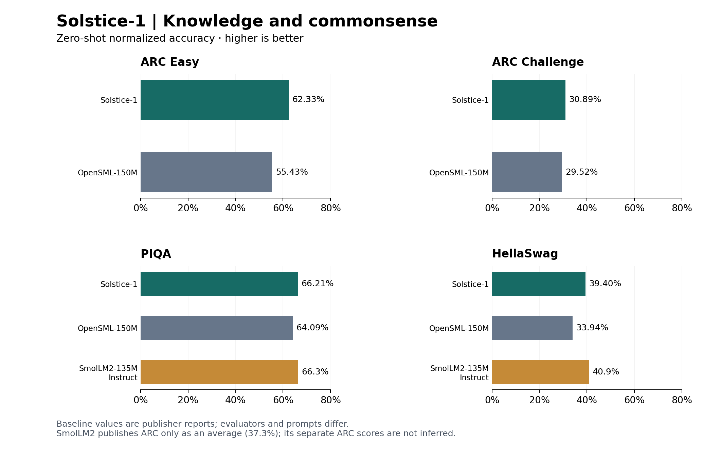
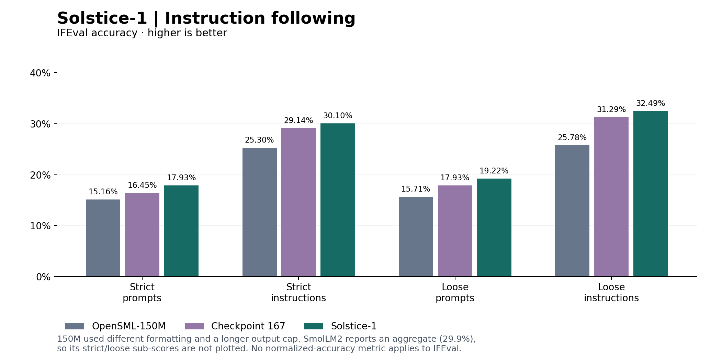
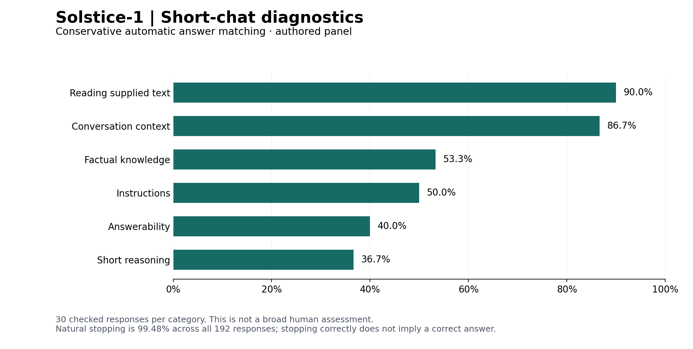

# Solstice-1 evaluation

All results identify the same release weight hash, `7b2d8777040f05d8e0849acac4e45013b2de3d72145c363cd22825e80115c515`. Public summary: [results/public/summary.json](../results/public/summary.json). The package verification is a separate check of loading/output parity, not a new training result.

## Likelihood scoring

| Benchmark | Metric | Solstice-1 | OpenSML-150M | SmolLM2-135M Instruct |
| --- | --- | --- | --- | --- |
| ARC Easy | Accuracy | 62.58% | 56.65% | — |
| ARC Easy | acc_norm | 62.33% | 55.43% | — |
| ARC Challenge | Accuracy | 29.35% | 26.02% | — |
| ARC Challenge | acc_norm | 30.89% | 29.52% | — |
| PIQA | Accuracy | 66.49% | 64.53% | — |
| PIQA | acc_norm | 66.21% | 64.09% | 66.3% |
| HellaSwag | Accuracy | 32.85% | 30.55% | — |
| HellaSwag | acc_norm | 39.40% | 33.94% | 40.9% |
| ARC (publisher average) | acc_norm | — | — | 37.3% |

Native MLX evaluates complete ARC Easy/Challenge test splits, PIQA validation and HellaSwag validation. It uses zero-shot raw completion prompts, no chat template or inserted BOS/EOS, FP32 weights, vanilla attention, batch size four and chunked scoring. Raw accuracy ranks summed continuation log-likelihood; normalized accuracy divides by choice Unicode-character count. No generated explanation or LLM judge determines the answer. No choices were context-truncated. Dataset revisions and scorer settings are preserved in [the result record](../results/public/choices/results.json).

## Instruction following

| IFEval accuracy | Solstice-1 | OpenSML-150M | SmolLM2-135M Instruct |
| --- | --- | --- | --- |
| Strict prompts | 17.93% | 15.16% | — |
| Strict instructions | 30.10% | 25.30% | — |
| Loose prompts | 19.22% | 15.71% | — |
| Loose instructions | 32.49% | 25.78% | — |
| Publisher prompt/instruction average | — | — | 29.9% |

Google IFEval is pinned to dataset revision `966cd89545d6b6acfd7638bc708b98261ca58e84` and google-research commit `83f1e7b59e762648c953de751d31f75720683622`. All 541 prompts and 834 instructions use the recorded strict/loose programmatic verifiers. Generation is greedy, native-chat formatted, FP32, without a system message or repetition penalty. Output cap: 1,024 tokens. Token-cap hits: **130/541**; context-cap hits: **0**. All generated responses are scored, including cap hits. The official dataset's split is named `train`; it is used as evaluation input here, not SFT training material.

## Published small-model references

Baseline scores come from the published [OpenSML-150M card](https://huggingface.co/OpenSML/OpenSML-150M) and [SmolLM2-135M-Instruct card](https://huggingface.co/HuggingFaceTB/SmolLM2-135M-Instruct), not fresh reruns. “—” means the required breakdown is not published in those cards. SmolLM2 reports ARC and IFEval as averages; no missing sub-scores are inferred.

Solstice uses native MLX FP32 scoring. SmolLM2 uses LightEval; its [evaluation code](https://github.com/huggingface/smollm/tree/438be18dae658a638f3a6976fdf5190bb6d68619/text/evaluation/smollm2) specifies character-normalized choice scores with a leading space excluded and instruct runs with a chat template. OpenSML-150M uses an older native pipeline. Prompt formatting, precision and generation budgets differ, so these are reference comparisons, not a controlled leaderboard. [Exact sources and metric definitions](../results/baselines/published_models.json).

Figure data is read directly from the saved JSON records by [plot_results.py](../scripts/plot_results.py). Run that script with matplotlib 3.10.8 to regenerate PNG and SVG figures. The SmolLM2 card does not identify how strict versus loose IFEval metrics contribute to its published average, so that average is not assigned to any one of Solstice's four IFEval metrics.

## Historical comparison

| Metric | Published 150M | 167 | Parent 2000 | Prior attempt 5 | Solstice-1 |
| --- | --- | --- | --- | --- | --- |
| ARC Easy acc_norm | 55.43% | 61.49% | 62.33% | 62.33% | 62.33% |
| ARC Challenge acc_norm | 29.52% | 30.46% | 30.63% | 31.23% | 30.89% |
| PIQA acc_norm | 64.09% | 65.67% | 66.43% | 66.43% | 66.21% |
| HellaSwag acc_norm | 33.94% | 38.60% | 39.51% | 39.44% | 39.40% |
| IFEval strict prompt | 15.16% | 16.45% | 14.97% | 15.53% | 17.93% |
| IFEval strict instruction | 25.30% | 29.14% | 26.86% | 28.18% | 30.10% |
| IFEval loose prompt | 15.71% | 17.93% | 16.82% | 16.45% | 19.22% |
| IFEval loose instruction | 25.78% | 31.29% | 29.62% | 30.34% | 32.49% |

Solstice, parent 2000, prior attempt 5 and 167 share the recorded native FP32 protocol. The 150M numbers are from its [published model card](https://huggingface.co/OpenSML/OpenSML-150M), not a fresh release-bundle rerun. Its IFEval uses plain `User:/Assistant:` formatting, EOS ID 1 and a 1,280-token cap; newer models use structural chat IDs and 1,024 tokens. The earlier choice run uses batch size one. These differences limit controlled head-to-head claims. No external-model leaderboard rank or statistical significance of every small benchmark difference is asserted.

JSONLite has different extraction panels, so its 89.54% extraction correctness and 99.93% schema validity are not comparable with these scores. No JSONLite ARC/IFEval score is inferred from its pretrained ancestor.

## Authored checks: keep denominators separate

| Panel | Parent 2000 | Prior attempt 5 | Solstice-1 |
| --- | ---: | ---: | ---: |
| Historical development answers | 197/320 | 204/320 | 200/320 |
| Historical final answers | 367/704 | 384/704 | 379/704 |
| New reserved authored panel | 200/1,000 | 259/1,000 | 519/1,000 |
| Separate chat answer matches | 102/180 | 101/180 | 107/180 |
| Separate chat natural stopping | 189/192 | 191/192 | 191/192 |
| Separate chat repetition flags | 4/192 | 2/192 | 3/192 |

The 320 development and 704 final counts arise from different selected evaluation subsets. They are not a single test that changed denominators. The 192-response chat panel contains 180 objectively checked cases plus 12 open-ended qualitative cases. Automatic answer matching is conservative; it is not comprehensive semantic review. The new panel contains five domains with 200 cases each. Solstice passes 172 abstention, 25 constraints, 194 dialogue, 81 grounded and 47 reasoning cases. Strict formatting reduces its total from 519 to 518.

Against parent 2000, the new-panel gain is 31.9 percentage points, with a 97.5% scenario-cluster paired bootstrap interval of 28.69–35.04 points. Against attempt 5, it is 26.0 points, interval 22.93–29.00. The method uses 10,000 draws and keeps paired present/missing-fact scenarios together. These intervals describe sampling variation within this authored task distribution; they do not measure all conversational ability or correct for the entire historical experiment program.

## Remaining failure modes

The new panel flags unnecessary abstention on 111/200 answerable extraction cases. Separately, all 15 differently worded missing-information chat cases fail appropriate abstention. Saved examples include invented values and copied irrelevant text, so this second issue is not explained solely by strict answer matching. Wording sensitivity remains a limitation even though the final selection guards passed.

Manual inspection of the three chat repetition flags found two clear loops and one milder repeated sentence/idea. Keep the original three-flag result for consistent comparisons; it does not mean all three are equally severe. All 180 objective chat responses stop naturally; the qualitative cases account for the single token-cap hit and the repetition flags.

## Selection and test exposure

The final five-trial search selected one checkpoint using the 300-case new development panel plus historical development, stopping, repetition and prose-retention guards. Finalist identity was frozen before the new 1,000-case test. Small tolerated regressions were part of the declared guards; passing them does not mean every metric improved. The complete comparison and selection record includes the thresholds and reasons.

Historical and public evaluations were used in earlier research, and some training tasks resemble evaluation task families. Exact exclusions do not establish semantic decontamination. No broad human study, safety certification, calibrated uncertainty test or verified real-world factuality score is claimed.
