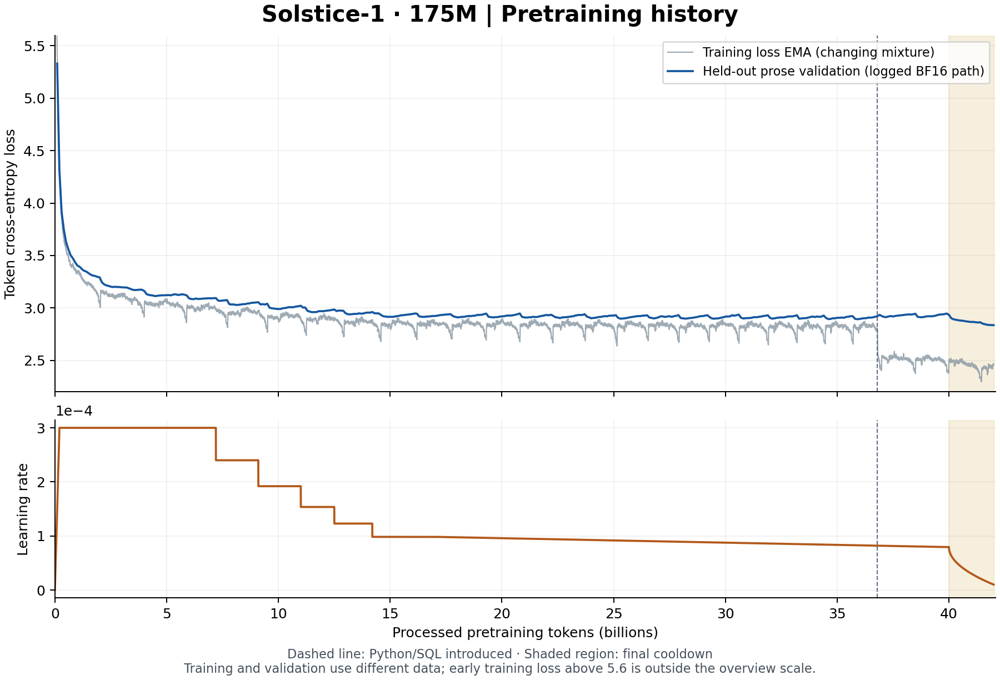
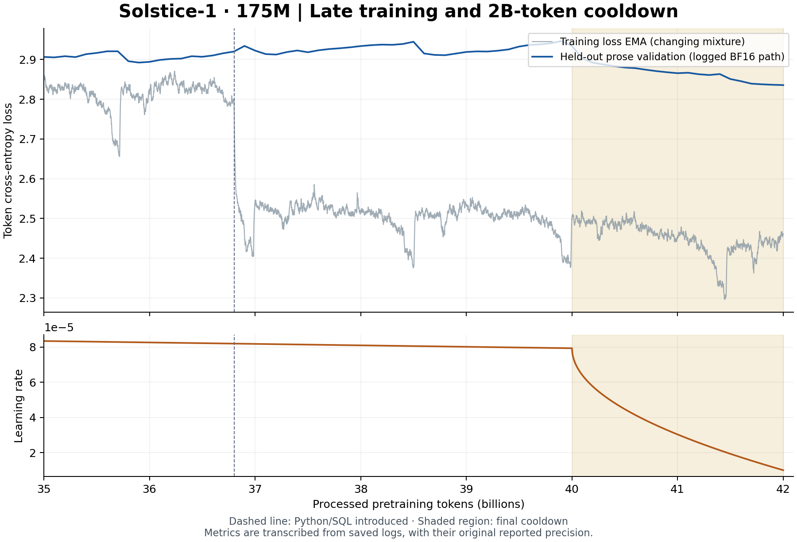

# Solstice-1 technical report

Author: William Zebrowski · Release candidate prepared 2026-11-09 · Public size designation: **175M**

## 1. Scope and identity

Solstice-1 is the merged FP32 export of final-stage checkpoint `step_0000128_5937a6def881`. It contains exactly **174,202,432 parameters**. The 175M name is a rounded public designation. This report describes the selected checkpoint rather than all experiments in the workspace.

Weight SHA-256: `7b2d8777040f05d8e0849acac4e45013b2de3d72145c363cd22825e80115c515`.

The complete tensor shape inventory is in [TENSOR_INVENTORY.json](../provenance/TENSOR_INVENTORY.json). The inference configuration is [config.json](../config.json). The published parameter count describes the merged dense model, not the number of trainable adapter parameters.

## 2. Architecture

The model is a decoder-only causal transformer with 44 residual blocks and hidden width 576. Attention uses a combined QKV projection, nine query heads, three KV heads, and head dimension 64. Each query/key head is RMS-normalized. Rotary position embeddings use base 10,000. Blocks use pre-normalization and SwiGLU; the actual FFN intermediate width is 1,536. The packed gate/up matrix has shape 3,072 × 576. Input embeddings and output projection are tied. There are no linear biases or dropout.

The model has a deeper, narrower shape than the earlier 24-layer, width-768 JSONLite model or 20-layer OpenSML-150M. These runs also differ in data, optimization, and training exposure, so their results do not isolate an architectural advantage.

Training uses MLX fast attention and packed Metal FFN/cross-entropy paths where specified by each frozen recipe. Release inference and the reported FP32 benchmarks use vanilla attention and reference FFN/cross-entropy paths. No quantization is applied to the release weights.

## 3. Tokenizer and serialization

The existing 32,000-token byte-level BPE tokenizer was reused unchanged. It was fitted for the earlier OpenSML project, not retrained on the entire Solstice corpus. Its manifest fingerprint is `1194292c6d906ac19e6f01c6ad2b42825143fad426a22aa8856d903776701ecb`. Token IDs are pad=0, document-end=1, turn-start=2, turn-end=3. The runner verifies the manifest, vocabulary and IDs. The tokenizer files and original corpus metadata are included.

Each chat message is serialized as ID 2, tokenized `role + "\n"`, tokenized content, and ID 3. Generation ends with an open assistant header. A training conversation additionally ends with document-end ID 1. Ordinary text that resembles a control token is encoded as ordinary text rather than injected structural IDs. Role headers and user/system text are masked from SFT loss. Assistant content and end markers are supervised according to the stage's loss mask.

The maximum context is 2,048 tokens. SFT preserves complete conversations and rejects oversized examples rather than truncating them. The largest stage-1 serialized training conversation is 1,385 tokens including its final boundary; the shifted input length recorded in its manifest is 1,384. Stage-2 authored tasks reach 115 serialized tokens; stage-3 authored tasks reach 137. Selected conversational replay is at most 512 serialized tokens. These maxima are data checks, not a claim that long-dialogue behavior is reliable.

## 4. Pretraining data and exposure

The model starts from random initialization with seed 7337. Initial token-mixture shares are 70% FineWeb-Edu, 20% DCLM-Edu, and 10% English FineWiki. At 36,801,216,512 lifetime tokens, training switches to 80% prose, 15% Python, and 5% SQL: web/DCLM/wiki become 56%/16%/8%. Python/SQL use public Stack-Edu text mirrors and the configured SQL continuation source. The final base contains **42,001,367,040 processed positions** at step 320,445.

These are processed token counts, not a measured inventory of globally unique training tokens. Sources are streamed with bounded buffering and deduplication. The all-available policy introduced during continuation bypasses the earlier 50-million-row ceiling; an inherited corpus field containing that number does not describe the active policy. The frozen recipes record the actual source policy.

The active stream records a 256-document shuffle buffer, 100,000-document deduplication window, four prefetched batches, and five read attempts. Exact source pins, phase changes, text/code filters and provenance are documented in [DATA.md](DATA.md). Identity partitioning and bounded duplicate checks do not establish semantic decontamination of internet-derived training data.

## 5. Distributed optimization and schedules

Pretraining uses five Apple Silicon workers connected for distributed communication. Per-worker microbatches are [7,3,2,2,2], with four gradient-accumulation microsteps and sequence length 2,048: **131,072 positions per optimizer update**. Gradient aggregation is weighted for unequal worker token counts. AdamW uses betas (0.9,0.95), epsilon 1e-8, weight decay 0.1 and gradient clipping at 1. BF16 compute is backed by FP32 master weights, optimizer state and gradient accumulation. Historical hardware/runtime configuration is archived; no new energy or cross-hardware throughput benchmark is asserted here.

| Boundary | Effective change |
| --- | --- |
| Start | Warm up over approximately 200M tokens to 3e-4; original 20B target |
| 5,655,101,440 tokens | Plateau controller: factor 0.8 after 10 non-improving evaluations; floor 3e-5 |
| 15,692,201,984 tokens | All-available streaming; hold inherited LR 9.8304e-5 |
| 16,984,178,688 tokens | Begin gradual linear decay toward 3e-5 at 100B lifetime tokens |
| 36,801,216,512 tokens | Introduce the 80/15/5 prose/Python/SQL mixture |
| 40,001,339,392 tokens | Begin final cooldown at 7.93658732685024e-5 |
| 42,001,367,040 tokens | Finish cooldown at 1e-5; selected pretrained base |

Cooldown lasts 2,000,027,648 additional positions. With progress p from 0 to 1, LR is `1e-5 + (start_lr - 1e-5) * (1 - sqrt(p))`. This is a substantial late reduction, unlike extending the previous 100B schedule unchanged. Earlier plateau state remains in metadata for provenance; it is not an active second controller during cooldown.

Nominal validation and checkpoint intervals are 100M tokens. Recorded training and validation curves are in [pretraining_steps.csv](../results/pretraining_steps.csv) and [pretraining_validation.csv](../results/pretraining_validation.csv); displayed log losses have the precision of the source logs. CSV token positions for validation are reconstructed from the constant 131,072-position batch and step counter.

The base checkpoint's saved BF16-path best prose validation loss is 2.8356336173. The FP32 base measurement used by SFT retention checks is 2.8353193145. Solstice-1's FP32 retention loss is 2.8633367460. These precision-specific measurements must not be silently combined. Python and SQL validation losses are separate from prose-best selection. Losses on these datasets cannot be compared directly with unrelated models' losses.

## 6. Selected fine-tuning lineage

| Stage | Inherited updates | Fresh/supervised presentations | Replay presentations | Peak → planned final LR |
| --- | --- | --- | --- | --- |
| SFT 1 | 2000 | 96,000 (48,000 unique conversations; two passes) | 32,000 prose sequences | 2e-4 → 2e-5 |
| SFT 2 | 256 | 4,096 authored tasks | 4,096 prior conversations | 5e-5 → 5e-6 |
| SFT 3 | 128 | 2,048 authored tasks | 2,048 prior conversations | 2e-5 → 2e-6 over 256 planned updates |

All three stages train locally on one Mac. Rank-32 LoRA adapters with alpha 64 and no dropout target attention QKV and output projections in all 44 blocks. The two tied chat-token embedding rows, IDs 2 and 3, are also trainable. There are **3,785,856 trainable parameters**. The original base is frozen, computed in BF16 during training; adapters use FP32. Each subsequent stage inherits the preceding adapters/token deltas and starts fresh AdamW moments. Stage metadata, source hashes, actual batch indices, and selected-prefix counts are in [provenance](../provenance/LINEAGE.json).

SFT 1 uses 48 conversation rows plus 16 prose-replay sequences per update, microbatch eight. Its loss combines 0.8 assistant-masked conversation loss with 0.2 prose replay. It makes two complete passes over 48,000 curated conversations. Warmup is 5% of 2,000 updates, followed by cosine decay. The selected checkpoint is final update 2,000, reproduced from the earlier attempt-9 recipe. It did not satisfy every earlier quality gate; preservation and later continuation are documented rather than recast as universal success.

SFT 2 uses 16 fresh tasks and 16 conversational-replay rows per update, microbatch four. The fresh mixture is 40% editing/skills, 40% constraints, 10% dialogue and 10% grounding, with integer rounding recorded in the selected-prefix file. Its objective is `0.5 * fresh_NLL + 0.5 * (replay_NLL + 0.5 * KL(parent || policy))`. The reference is a frozen copy of its immediate parent. Fresh tasks supervise the final assistant answer; replay supervises all assistant turns. This is supervised fine-tuning with parent-distribution preservation, not DPO or reinforcement learning. The preserved attempt-5 reproduction is selected at update 256.

SFT 3 plans 256 updates with the same 16+16 batching, 10% warmup and cosine schedule. Its objective is `0.4 * fresh_NLL + 0.6 * (replay_NLL + 0.25 * KL(parent || policy))`. Thus the effective outer KL coefficient is 0.15. The configured fresh draw is 60% short reasoning, 15% grounding, 15% dialogue and 10% abstention. Solstice inherits only the first 128 updates: **1,230 reasoning, 324 grounding, 306 dialogue and 188 abstention presentations**, plus 2,048 replay presentations. The selected prefix differs slightly from the full planned proportions because batches are deterministically shuffled and grouped by length.

All SFT stages use AdamW betas (0.9,0.95), epsilon 1e-8, no weight decay, gradient clipping at 1, and no dropout. Stage seeds are 202611053, 202611097, and 2026110915. Stage-3's selected step is halfway through a 256-update schedule; the planned final 2e-6 rate is not falsely attributed to update 128.

Selected recorded assistant-token totals are 4,440,608, 279,606 and 120,629 by stage. Recorded input-position totals are 29,271,514, 816,428 and 411,448; stage 1 includes its prose replay. Counts describe training presentations and processed positions, not unique documents across all stages.

No new external teacher model was called to label these stages. Public SmolTalk-family sources include upstream synthetic responses. Parent KL preservation uses a frozen local reference during training. Inference requires only the merged model.

## 7. Export precision and selection

The inference export combines original FP32 pretrained masters with FP32 adapter and tied-token deltas. It does not merely cast rounded BF16 base weights back to FP32. The merged tensor file is exactly the one evaluated in the saved public suite; no optimizer or training corpus is required for inference. Hash checks and native-package verification are recorded separately from training metrics.

Five bounded repair experiments were compared using a new 300-case development panel and historical 320-case guards. Experiment 4, update 128, was frozen as the finalist before opening the reserved 1,000-case test. The selection rule prioritized new-panel correctness among candidates meeting the predeclared retention/behavior tolerances. It did not maximize every historical metric: another checkpoint could score higher on a particular reused test.

A scoring correction during setup separated content correctness from exact formatting. The initial trial-1 prefix was restarted under the corrected evaluator; its reproduced step-64 adapter/optimizer hashes matched. This was not an extra training recipe. The evidence records the five experiments, selection rules and scoring scope.

The selected model scores 519/1,000 on the reserved authored panel versus 200 for parent 2000 and 259 for the prior attempt 5. Scenario-cluster bootstrap intervals support improvement within that panel, not universal chat superiority. Historical 704-case scores are 379, 367 and 384 respectively: the finalist improves over parent 2000 but trails attempt 5 on this separate check. See [EVALUATION.md](EVALUATION.md).

## 8. Limitations and reproducibility

The strongest new-panel gains do not establish broad factuality. The model still over-abstains on some answerable inputs and invents missing facts under different wording. Longer instructions frequently hit the output cap. Repetition flags and low strict IFEval prompt accuracy remain. Coding, SQL and JSON capabilities are not release claims merely because code appeared in pretraining.

The report includes exact checkpoint identities, source/dataset revisions, batch-selection indices, recorded metrics and sanitized training-source snapshots. Original raw corpora, resumable optimizer state and all intermediate weights are not bundled. Source paths and local network addresses were sanitized and changes are recorded. Reconstructing a historical run requires the external assets and compatible runtime described in [TRAINING_AND_REPRODUCIBILITY.md](../TRAINING_AND_REPRODUCIBILITY.md); exact end-to-end retraining has not been independently rerun.
